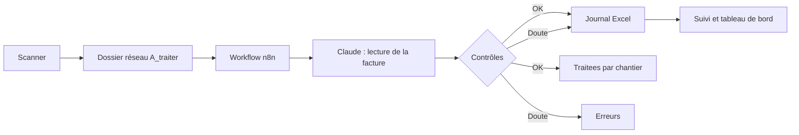

# Modèle : factures fournisseurs, paiements et analytique de chantier (Excel + n8n)

Modèle autonome pour une petite entreprise du bâtiment qui veut suivre ses factures fournisseurs, leurs paiements et le
coût de ses chantiers avec **Excel** et **n8n**, sans passer par l'application auto. Les factures scannées déposées dans
un dossier du réseau local sont lues par Claude, inscrites dans le classeur, puis rangées par chantier.

Pour la même fonction dans l'application, voir `packages/ingest` (factures reçues), `docs/AUTOMATISATIONS.md`
(workflows natifs ; `auto flux importer` convertit ce workflow n8n et signale les nœuds à remplacer) et `docs/N8N.md`.

## Contenu

| Dossier     | Fichier                                   | Rôle                                                                                  |
| ----------- | ----------------------------------------- | ------------------------------------------------------------------------------------- |
| `classeur/` | `Classeur_Factures_Fournisseurs.xlsx`     | Journal, paiements, suivi, tableau de bord, exports comptables (11 onglets)           |
| `workflow/` | `Workflow_n8n_Factures_Fournisseurs.json` | Workflow n8n à importer : lecture des scans, ajout au Journal, rangement, relances    |
| `guides/`   | `GUIDE_SIMPLE.html`                       | Guide pas à pas pour un utilisateur non technicien (à ouvrir dans un navigateur)      |
| `guides/`   | `GUIDE_MISE_EN_SERVICE.md`                | Mise en service du classeur et du workflow, pour la personne qui installe             |
| `video/`    | `video_automatisation_factures.mp4`       | Présentation du procédé, 1080p, voix off française (4 min 10)                         |
| `outils/`   | `creer_*.py`, `workflow.test.ts`          | Scripts qui régénèrent les fichiers ci-dessus et testent le code embarqué du workflow |

Les guides désignent les fichiers par leur nom seul : ils se trouvent dans les sous-dossiers ci-dessus.

## Fonctionnement



- Le **Journal** et les **Paiements** sont les seuls onglets à alimenter. Le **Suivi** calcule le reste dû, les retards,
  les statuts (À payer, Partiellement payée, En retard, Payée, Litige, Trop payé, Doublon) et neutralise les doublons.
- Les exports `Export_compta` (achats) et `Export_banque` (règlements) produisent des écritures prêtes à importer.
- Le workflow envoie chaque matin un récapitulatif des factures en retard, à payer sous 7 jours ou à vérifier.

## Mise en service rapide

1. Utiliser d'abord le classeur seul (partie 1 de `guides/GUIDE_SIMPLE.html`), après avoir supprimé les lignes dont la
   colonne _Source_ vaut `EXEMPLE`.
2. Pour automatiser : placer le classeur dans OneDrive, définir `NODES_EXCLUDE=[]` dans n8n 2.x (les nœuds _Local File
   Trigger_ et _Execute Command_ sont désactivés par défaut), importer le workflow, puis relier les credentials
   (en-tête `x-api-key` pour l'API Anthropic, Microsoft Excel OAuth2, SMTP).

## Régénérer les fichiers

```sh
python outils/creer_classeur.py     # nécessite : pip install openpyxl
python outils/creer_workflow.py
bun test outils                     # code JavaScript embarqué du workflow
python outils/creer_video.py        # Windows ; nécessite : pip install pillow imageio-ffmpeg
```

Les formules du classeur ont été vérifiées avec LibreOffice (aucune erreur, équilibre débit/crédit à 0). Le code
JavaScript du workflow est testé par `outils/workflow.test.ts` (inclus dans `bun test`).

## Limites connues

- Le workflow n'a pas été exécuté sur une instance n8n : faire un essai sur quelques factures réelles avant usage.
- Le classeur n'a pas été ouvert dans Excel lui-même : les valeurs se calculent à l'ouverture.
- Les factures sont envoyées à l'API Anthropic pour lecture : vérifier la confidentialité et le RGPD. Chaque lecture
  coûte quelques centimes.
- Un scan est traité par exécution, et une référence de chantier lue sur la facture qui ne correspond à aucun code du
  classeur place la facture en `A_AFFECTER`.
- Les données du classeur sont des **exemples fictifs** (colonne _Source_ = `EXEMPLE`). Ne jamais y mettre de donnée
  client réelle dans ce dépôt.
